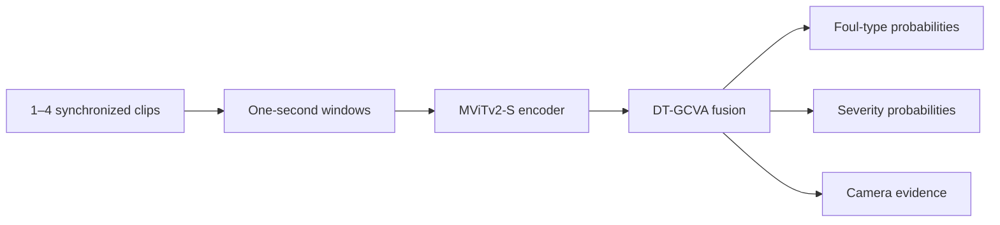

# RefereeAI

**Multi-view AI assistance for reviewing football incidents.**

[Try the live research prototype](https://app.referee-ai.workers.dev/) ·
[Evaluation report](experiments/FINAL_FROZEN_TEST_20260928.md) ·
[Deployment guide](deploy/README.md)

RefereeAI analyses one to four synchronized clips of the same football incident
and returns foul-type probabilities, offence-severity probabilities, and a view
of the evidence used by the model. It is an experimental decision-support tool:
the final judgement always belongs to the referee or VAR team.

## What it does

- Accepts 1–4 synchronized camera views, each no longer than five seconds.
- Divides every clip into one-second temporal windows.
- Encodes visual evidence with an MViTv2-S video backbone.
- Fuses views and time windows with Dual-Task Gated Cross-View Attention
  (DT-GCVA).
- Predicts eight foul types and four offence-severity classes.
- Shows probability distributions and camera contribution instead of presenting
  a prediction as a definitive call.
- Provides three prepared multi-camera examples on the public website; live GPU
  analysis is access-controlled to manage compute cost.

RefereeAI analyses an already identified short incident. It does **not** scan a
full match, automatically detect incidents, or replace an official.

## Evaluation and limitations

The final checkpoint was selected on the validation split and evaluated once on
an untouched SoccerNet-MVFoul test split. The evaluation shows that this is a
working research prototype, not a production-ready officiating model. Rare foul
and sanction categories remain especially challenging, and the learned attention
should be interpreted as exploratory evidence attribution rather than validated
temporal localization.

For reproducibility and transparency, the full metrics, per-class results,
confusion matrices, and evaluation-integrity details remain available in the
[frozen-test report](experiments/FINAL_FROZEN_TEST_20260928.md).

## System overview



The hosted application separates the public frontend, protected upload gateway,
and private GPU service:

```text
Vite frontend
    → Cloudflare Worker + R2 + Durable Object
    → private Modal GPU inference endpoint
```

Uploads are temporary. The gateway applies file validation and usage limits,
signs short-lived inference requests, and removes uploaded objects after the
request. Deployment details and required secrets are documented in
[`deploy/README.md`](deploy/README.md).

## Run locally

### 1. Install the Python environment

Python 3.10 or newer is required.

```bash
python -m venv .venv
source .venv/bin/activate
python -m pip install torch torchvision
python -m pip install -r requirements.txt
python -m pytest -q
```

On Windows, activate the environment with `.venv\Scripts\activate`. A CUDA
machine must install the PyTorch build appropriate for its CUDA version.

### 2. Obtain the dataset

SoccerNet-MVFoul is not included in this repository. Request access from the
[official SoccerNet-MVFoul project](https://github.com/SoccerNet/sn-mvfoul),
then follow [`data/README.md`](data/README.md) to download and validate it.

```bash
python -m scripts.inspect_dataset --data-root /absolute/path/to/SoccerNet
```

### 3. Start the local application

Start the inference API from the repository root:

```bash
TORCH_HOME="$PWD/.cache/torch" .venv/bin/python -m scripts.inference_api
```

In another terminal, start the frontend:

```bash
cd frontend
npm install
npm run dev -- --host 127.0.0.1
```

## Training and evaluation

The repository provides configuration-driven scripts for the VARS baseline,
cached-feature experiments, and the five-window DT-GCVA model. For example:

```bash
python -m scripts.train_baseline \
  --data-root /absolute/path/to/SoccerNet \
  --config configs/dt_gcva.yaml \
  --output experiments/runs/dt-gcva-seed42 \
  --device cuda
```

Training outputs include the resolved configuration, environment information,
annotation summaries, epoch logs, and best/latest checkpoints. Evaluation writes
aggregate and per-class metrics plus probability vectors and camera weights.
The documented experimental protocol and implementation assumptions are in
[`docs/BASELINE.md`](docs/BASELINE.md) and
[`docs/PHASE2_DTGCVA.md`](docs/PHASE2_DTGCVA.md).

## Repository structure

| Path | Contents |
|---|---|
| `src/datasets/` | SoccerNet-MVFoul parsing, filtering, decoding, and feature caching |
| `src/models/` | MViT encoder, VARS baseline, and DT-GCVA models |
| `src/training/` | Loss functions and training loop |
| `src/evaluation/` | Classification metrics and confusion matrices |
| `configs/` | Reproducible experiment configurations |
| `scripts/` | Dataset, training, evaluation, and inference entry points |
| `tests/` | Unit and integration tests |
| `frontend/` | React/Vite web application and prepared demo cases |
| `deploy/` | Cloudflare Worker and Modal deployment code |
| `docs/` | Methodology, scope, and reproduction notes |
| `experiments/` | Curated human-readable experiment reports |

Large datasets, checkpoints, feature caches, local environments, generated
artifacts, and build outputs are intentionally excluded from Git. The prepared
website clips included here are the only video assets cleared for redistribution.

## Responsible use

Model probabilities are uncalibrated and may be wrong. The system has limited
data for rare classes, performs poorly on several foul categories, and is not a
reliable red-card detector. Outputs must always be reviewed alongside the
original footage and applicable competition rules. Do not use this prototype as
the sole basis for an officiating, disciplinary, or safety-critical decision.

## Reference

The baseline and dataset conventions build on:

> Held et al., “VARS: Video Assistant Referee System for Automated Soccer
> Decision Making from Multiple Views,” 2024.
> [Paper](https://arxiv.org/abs/2407.12483) ·
> [Official code and dataset](https://github.com/SoccerNet/sn-mvfoul)

DT-GCVA is the experimental spatiotemporal fusion method implemented in this
repository. No superiority over VARS is claimed without a controlled comparison.

## License

The source code is released under the [MIT License](LICENSE). SoccerNet-MVFoul,
pretrained weights, and other third-party materials remain subject to their own
licenses and access terms.
